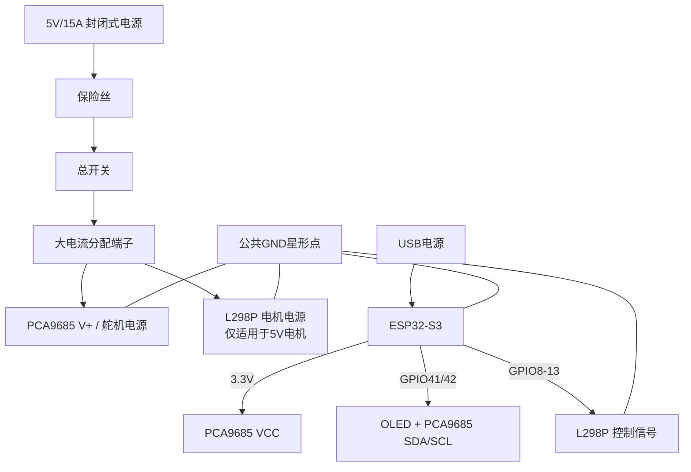

# 瓦力 ESP32-S3 接线与电源采购指南

本文针对当前工程的 `wall-e-s3` 板型，目标硬件为：ESP32-S3 N16R8、1.3 寸 128×64 OLED、PCA9685 舵机扩展板、L298P 双路电机驱动板，以及 MG90S/MG92B 舵机。

配套文档：

- [可直接勾选的采购清单](wall-e-s3-purchase-checklist-zh-CN.md)
- [首次上电与舵机/电机校准检查表](wall-e-s3-bringup-checklist-zh-CN.md)

先记住三条规则：

1. ESP32、OLED、PCA9685 的逻辑信号可以使用 3.3V；舵机和电机不能由 ESP32 或面包板供电。
2. PCA9685 的 `VCC` 是逻辑电源，`V+` 是舵机电源，二者不能混接。
3. 所有模块的 `GND` 必须共地，但大电流舵机/电机电流不能经过面包板和杜邦线。

## 一、建议购买清单

### 已有或继续使用

| 数量 | 材料 | 说明 |
|---:|---|---|
| 1 | ESP32-S3 N16R8 开发板 | 继续使用当前语音交互设备 |
| 1 | 1.3 寸 128×64 OLED | 当前按 SH1106、I²C、地址 `0x3C` 配置；以模块实际丝印为准 |
| 1 | PCA9685 蓝色舵机板 | 默认地址 `0x40`；A0–A5 不短接 |
| 1 | L298P 双路电机驱动板 | 使用 ENA/IN1/IN2 和 ENB/IN3/IN4 |
| 4 | MG90S | 眼睛、胳膊或轻载机构 |
| 4 | MG92B | 脖子、转头或较大负载机构 |

当前固件只启用 7 个舵机通道；第 8 个通道 CH7 保留并禁用。如果实际只安装 7 个舵机，将未安装位置留空即可。

### 强烈建议购买

| 数量 | 材料 | 规格建议 |
|---:|---|---|
| 1 | 稳压 5V 大电流电源 | 台式测试建议 5V、10A 以上，推荐 15A；新手优先购买封闭式桌面适配器，不要购买裸露市电端子的开放式电源 |
| 1 | 电源总开关 | 直流额定电流不低于 15A |
| 1 | 保险丝或自恢复保险 | 按实际电源和电机电流选择，放在电源正极入口 |
| 1 | 电源分配端子/接线排 | 额定电流不低于 15A；不要用面包板电源轨承载舵机和电机电流 |
| 1 | 2200–4700µF、10V 或更高电压电解电容 | 接在 PCA9685 的舵机 `V+` 与 `GND` 之间，注意极性 |
| 2 | 0.1µF 陶瓷电容 | 每个直流电机两端并联一个，用于抑制电刷噪声 |
| 若干 | 14–16 AWG 电线 | 5V 电源主干线；线越长越应选择较粗规格 |
| 若干 | 18–22 AWG 电线 | 电机线和各舵机电源支线 |
| 若干 | 24–26 AWG 杜邦线 | 仅用于 SDA/SCL、PWM、IN1–IN4 等信号 |
| 若干 | 螺丝端子、压接端子、热缩管 | 电源和电机线建议使用端子，不要裸线缠接 |
| 1 | 万用表 | 上电前测电压和短路，必备 |

### 移动供电时再购买

如果不使用台式 5V 电源，而要让机器人移动，需要另外购买：

- 2S 锂电池组（标称 7.4V）
- 与电池匹配的 2S 保护板/BMS 和充电器
- 5V、15A 左右的降压模块（应能持续输出，不是只标峰值；需要良好散热）
- 电池插头、保险丝和总开关

如果按 5V/15A 的满功率设计，2S 电池、BMS、插头和主线都需要有足够的持续放电能力；建议按至少 15A 持续电流选型，并给启动峰值留余量。

不要直接把 7.4V 电池接到 MG90S/MG92B 或 5V 电机。若电机铭牌不是 5V，需要为电机单独配置符合铭牌电压的电源。

## 二、ESP32-S3 信号接线

下面是当前固件 `main/boards/wall-e-s3/config.h` 的 GPIO 分配。麦克风、扬声器和 OLED 已经能正常工作时，原有接线保持不变。

| 功能 | ESP32-S3 GPIO | 连接到 |
|---|---:|---|
| 麦克风 WS | GPIO4 | 现有麦克风 WS |
| 麦克风 SCK/BCLK | GPIO5 | 现有麦克风 SCK |
| 麦克风 DIN | GPIO6 | 现有麦克风数据 |
| 扬声器 DOUT | GPIO7 | 现有扬声器数据 |
| 扬声器 BCLK | GPIO15 | 现有扬声器 BCLK |
| 扬声器 LRCK/WS | GPIO16 | 现有扬声器 LRCK |
| OLED + PCA9685 SDA | GPIO41 | 两个模块的 SDA 并联 |
| OLED + PCA9685 SCL | GPIO42 | 两个模块的 SCL 并联 |
| L298P ENA | GPIO8 | 左电机 PWM 使能 |
| L298P IN1 | GPIO9 | 左电机方向输入 1 |
| L298P IN2 | GPIO10 | 左电机方向输入 2 |
| L298P ENB | GPIO11 | 右电机 PWM 使能 |
| L298P IN3 | GPIO12 | 右电机方向输入 1 |
| L298P IN4 | GPIO13 | 右电机方向输入 2 |
| 3V3 | 3.3V | PCA9685 `VCC`，不是 `V+` |
| GND | GND | PCA9685 GND、L298P GND 共地 |

GPIO8–13 是当前工程的默认假设。若你的 L298P 已经接到其他 GPIO，只需要修改 `config.h` 中的 6 个电机 GPIO 定义，并重新编译。

OLED 与 PCA9685 共用 I²C 时，总线高电平必须是 3.3V。PCA9685 `VCC` 接 3.3V；OLED 如果支持 3.3V，也应继续使用 3.3V。不要让任一模块的上拉电阻把 SDA/SCL 拉到 5V。

## 三、PCA9685 与舵机接线

### PCA9685 逻辑侧

| PCA9685 引脚 | 连接 |
|---|---|
| VCC | ESP32-S3 3.3V |
| GND | 系统公共 GND |
| SDA | GPIO41，与 OLED SDA 并联 |
| SCL | GPIO42，与 OLED SCL 并联 |
| OE | 接 GND，使输出默认使能；不要悬空 |
| V+ | 外部 5V 舵机电源正极 |

PCA9685 的 `VCC` 只给芯片逻辑供电；8 个舵机的红线全部接在 `V+` 电源分配侧，不能接 3.3V，也不能从 ESP32 的 5V/USB 小电流供电。

### 舵机通道

舵机三根线通常为：棕/黑 = GND，红 = V+，橙/黄 = 信号。不同厂家的颜色可能不同，以舵机说明书为准。

| PCA9685 通道 | 当前功能 | 舵机型号建议 |
|---:|---|---|
| CH0 | 左眼 | MG90S |
| CH1 | 右眼 | MG90S |
| CH2 | 左臂 | MG90S 或 MG92B |
| CH3 | 右臂 | MG90S 或 MG92B |
| CH4 | 下脖子 | MG92B |
| CH5 | 上脖子 | MG92B |
| CH6 | 转头 | MG92B |
| CH7 | 预留，固件禁用 | 暂不接 |

舵机插头插入 PCA9685 时，三列必须对应 `GND / V+ / PWM`。不要只看插头方向；先看板上的丝印。

## 四、L298P 与电机接线

不同厂家 L298P 板的端子名称不完全一致，先对照板上丝印。典型连接如下：

| L298P 端子 | 连接 |
|---|---|
| ENA | GPIO8；如果有 ENA 跳线，拆除跳线后接 GPIO |
| IN1 | GPIO9 |
| IN2 | GPIO10 |
| OUT1/OUT2 | 左侧电机两根线 |
| ENB | GPIO11；如果有 ENB 跳线，拆除跳线后接 GPIO |
| IN3 | GPIO12 |
| IN4 | GPIO13 |
| OUT3/OUT4 | 右侧电机两根线 |
| GND | 系统公共 GND |
| 电机电源 `VM`/`+12V`/`MOTOR+` | 按电机铭牌接对应电压 |
| `5V` 逻辑端 | 严格按照 L298P 板说明书处理 |

### 关于“L298P 5V”

“5V”可能指逻辑电源，也可能指电机额定电压，不能仅凭板子名称判断。请确认：

- 如果是 5V 电机，L298P 的压降会明显降低电机端实际电压，可能出现启动困难、速度低和发热。
- 如果 L298P 板要求 5V 逻辑电源，应给它稳定的 5V；不要把 5V 直接接入 ESP32 的 GPIO。
- 某些驱动板的 `5V` 端在稳压跳线启用时是输出端，在其他配置下才是输入端；没有确认原理图前，不要同时连接板载 5V 和外部 5V。
- 如果 GPIO 高电平识别不可靠，可增加 74AHCT125/74HCT245 等 3.3V 到 5V 电平转换器。
- 对 5V 小车电机，TB6612FNG 或 DRV8833 通常比 L298P 更合适；如果已经购买 L298P，可以先低速、短时测试。

第一次测试时把机器人架空，让车轮离开地面。确认方向后，如果前进/后退相反，交换该电机两根 `OUT` 线，或调整软件方向，不要在带电状态插拔电机线。

## 五、推荐供电拓扑

### 台式测试方案（推荐先用）



```text
稳定 5V/15A 电源
        │
        ├── 保险丝 ── 总开关 ── 电源分配端子 ── PCA9685 V+
        │                                └── L298P 电机/逻辑电源（按说明书）
        │
        └── 电源负极 ── 公共 GND ── PCA9685 GND
                                  ├── L298P GND
                                  └── ESP32-S3 GND

ESP32-S3 3.3V ───────────── PCA9685 VCC
ESP32-S3 GPIO41/42 ──────── OLED + PCA9685 SDA/SCL
ESP32-S3 USB ─────────────── 只给 ESP32 和现有音频/屏幕供电
```

ESP32 使用 USB、舵机和电机使用外部 5V 时，必须连接公共 GND。不要把两个不同的 5V 输出直接并联，也不要在不了解开发板电源路径时把外部 5V 反灌到 ESP32 的 USB/5V 引脚。

### 电池方案

```text
2S 7.4V 电池
      │
      ├── 保险丝 ── 总开关 ── 5V/15A 降压 ── PCA9685 V+
      │                                      └── L298P（若电机为5V）
      └── BMS/充电器

ESP32-S3 可先由 USB 供电；最终整机供电时再使用独立的 5V/3.3V 稳压模块，避免电机噪声影响语音系统。
```

## 六、首次上电顺序

可打印版本见：[首次上电与校准检查表](wall-e-s3-bringup-checklist-zh-CN.md)。

1. 断开所有电源，检查没有把 PCA9685 `V+` 接到 `VCC` 或 ESP32 3.3V。
2. 舵机全部拆下舵盘/连杆，电机让车轮离地；L298P 的 ENA/ENB 跳线按需要拆除。
3. 只接 ESP32、OLED、PCA9685 逻辑侧（VCC、GND、SDA、SCL），用 USB 启动并确认语音和屏幕正常。
4. 用万用表测外部舵机电源，空载应为约 5.0V；确认正负极后再接 PCA9685 `V+`。
5. 只接一个舵机，测试 `neutral`、`eyes_left` 或 `look_up`；确认方向和机械范围后再接其他舵机。
6. 接入 L298P，先不接电机，用万用表和断电检查确认 `GND` 共地、信号线没有接到电源。
7. 接好电机后保持车轮离地，只发送低速、短时动作；确认 `stop` 可以立即停车。
8. 所有动作正常后再装舵盘、连杆和外壳，并把电源线固定、绝缘和应力释放。

## 七、常见故障排查

| 现象 | 优先检查 |
|---|---|
| OLED 正常但舵机无动作 | PCA9685 `V+` 是否有 5V；`OE` 是否接 GND；PCA9685 地址是否为 `0x40` |
| 舵机抖动、ESP32 重启 | 舵机电源电流不足；电源线太细；PCA9685 `V+` 旁是否有 2200–4700µF 电容；是否共地 |
| 电机不转 | ENA/ENB 跳线、L298P 电机电源、GND、OUT 端子和电机额定电压 |
| 一发语音就重启 | 电机/舵机电源噪声或压降；不要从 ESP32/面包板取大电流 |
| 前进变后退 | 交换对应电机 OUT 两根线，或修改软件方向 |
| 只有一个方向转 | 检查对应 IN1/IN2 或 IN3/IN4 是否接反、悬空或短路 |

## 八、买齐后的最小可用组合

如果想先在桌面完成验证，最少准备：

```text
5V/15A 稳压电源
保险丝 + 总开关 + 电源分配端子
2200–4700µF/10V 电解电容
14–16 AWG 电源主线、18–22 AWG 支线和匹配端子
万用表
```

先不要装电池，也不要让机器人落地行走。完成桌面测试、确认舵机方向和电机方向后，再增加电池、BMS、降压模块和机械结构。
